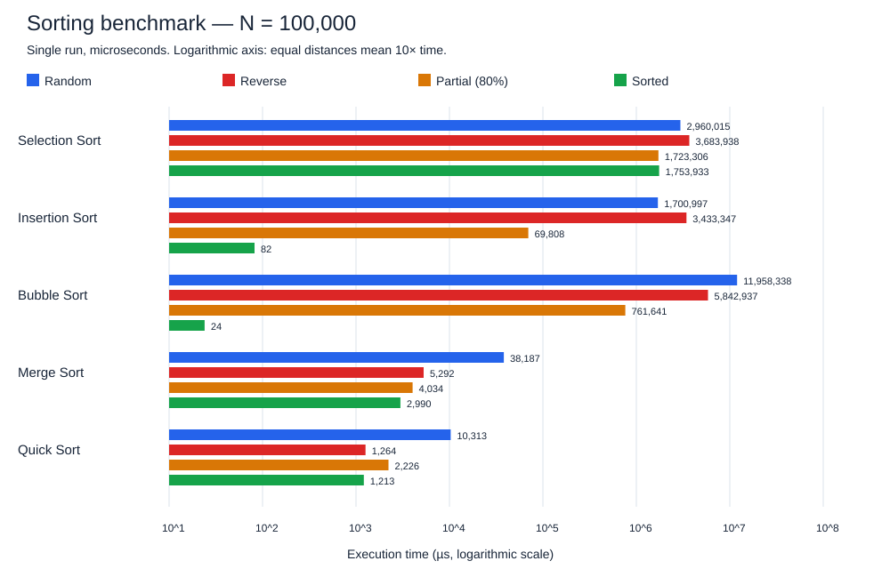

# Sorting Algorithms Benchmark
Data Structures 2 practical assignment — Java

## Student details
- Name: **[Enter your name]**
- University ID: **[Enter your ID]**
- Section: **[Enter your section]**

## Run
Install a JDK (tested with Eclipse Adoptium OpenJDK 17.0.17). From the repository folder:

```sh
javac SortingBenchmark.java
java SortingBenchmark
```

No external libraries or build tools are needed. The array size is fixed at **100,000**. Quadratic algorithms may take a while; a progress message appears after each algorithm. The final console table contains times in **microseconds (µs)**.

## Program structure
The program uses integer arrays, loops, methods, a switch statement, and recursion. Each sorting algorithm is implemented manually in its own method.
- Selection Sort repeatedly selects the smallest remaining element.
- Insertion Sort inserts each element into the sorted prefix.
- Bubble Sort exchanges adjacent elements and stops after a pass without swaps.
- Merge Sort recursively divides the array and merges sorted halves.
- Quick Sort partitions around the value at the middle position and recursively sorts both partitions.

## Input cases and fair measurement
A fixed random seed (42) generates 100,000 integers from 0 through 999,999, including possible duplicates. All four cases contain the same multiset of values.
1. **Random:** generated order.
2. **Reverse:** descending order.
3. **Partially sorted:** start sorted, keep the first 80% ordered, and shuffle only the last 20%. This is our explicit interpretation of approximately 80% sorted; scattered disorder could produce different results.
4. **Sorted:** ascending order.

Before each call, `Arrays.copyOf` makes an independent copy. Timing begins after copying and ends immediately after sorting. The difference from `System.nanoTime()` is divided by 1000 using integer division. Input generation, copying, validation, and printing are excluded. Merge Sort's temporary arrays are allocated inside the algorithm and are included.

`Arrays.sort` is used only to prepare the input cases, never to implement a measured sorting algorithm. Each result is checked for ascending order after timing.

## Measured results
Measured on 28 October 2026 using OpenJDK 17.0.17 in the development environment. These are actual single-run results, not predicted values. Run on your own computer and update the table and chart for your final report.

| Algorithm | Random (µs) | Reverse (µs) | Partial 80% (µs) | Sorted (µs) |
|---|---:|---:|---:|---:|
| Selection Sort | 2,960,015 | 3,683,938 | 1,723,306 | 1,753,933 |
| Insertion Sort | 1,700,997 | 3,433,347 | 69,808 | 82 |
| Bubble Sort | 11,958,338 | 5,842,937 | 761,641 | 24 |
| Merge Sort | 38,187 | 5,292 | 4,034 | 2,990 |
| Quick Sort | 10,313 | 1,264 | 2,226 | 1,213 |



The chart uses a logarithmic axis so both very small and very large times remain visible. It is a static chart of the table above; rerunning Java does not regenerate it.

## Analysis and discussion
### Quadratic versus O(N log N)
Selection Sort always scans the remaining suffix, performing N(N−1)/2 comparisons, so its time complexity is Θ(N²) in every input case. Insertion Sort and Bubble Sort have O(N²) average and worst cases. With 100,000 values, their nested loops can require billions of comparisons or movements.

Merge Sort has Θ(N log N) time in every case. Quick Sort has O(N log N) average time but O(N²) worst-case time. In this run, both were much faster than the quadratic sorts on random and reverse inputs. Timing differences among Selection Sort cases do not change its complexity; branch behavior and JVM execution also affect elapsed time.

### Sorted and partially sorted data
Bubble Sort was fastest on the fully sorted input in this run (24 µs), followed by Insertion Sort (82 µs). Bubble Sort finishes after one pass without swaps; Insertion Sort performs one failed shift comparison per element. Both have Θ(N) best-case time.

For our partially sorted input, Quick Sort was fastest (2,226 µs), followed by Merge Sort (4,034 µs). Insertion Sort improved substantially compared with random input because only the shuffled tail needs rearrangement. It can still perform many shifts within that tail. Bubble Sort also improved but may require many passes. Selection Sort does not take advantage of existing order.

### Quick Sort and the pivot
This implementation chooses the **value at the middle array position**, which is not necessarily the median value. On sorted and reverse inputs it tends to split partitions evenly, explaining its good results here. With a first- or last-element pivot and a conventional one-sided partition, sorted and reverse inputs can repeatedly produce partitions of sizes 0 and N−1, causing O(N²) work and deep recursion.

A middle-position pivot does not guarantee balanced partitions for every possible input. This implementation still has O(N²) worst-case time and can have deep recursion on adversarial inputs. The two-pointer partition moves both pointers after a swap, including when values equal the pivot, so duplicate values do not prevent progress.

### Space
Selection, Insertion, and Bubble Sort use O(1) auxiliary space. Merge Sort needs O(N) peak auxiliary array space plus O(log N) recursion depth. Quick Sort uses O(log N) stack space with balanced partitions and O(N) stack space in the worst case.

### Measurement limitations
This simple classroom benchmark runs each combination once, in a fixed order, without a separate JVM warm-up. JIT compilation, garbage collection, background activity, and CPU speed affect results. Microseconds are the output unit, not a guarantee of timing accuracy. Treat the table as an observation, not a universal ranking. For more stable comparisons, repeat runs and compare medians while keeping input generation and copying outside the timed interval.

## Validation
The program compiled successfully, and all 20 full-size algorithm/case combinations completed with sorted output. A separate development check compared all five implementations against `Arrays.sort` on arrays of lengths 0 through 100 with negative and duplicate values (505 comparisons). Input checks confirmed descending/ascending order, the sorted 80% prefix, and equal multisets across cases.

## Prepare for the lab
Fill in your student details, rerun the program on your own machine, and understand each algorithm before presenting. Be ready to trace insertion shifts, a merge, a Quick Sort partition, and explain why copying is outside the timer. Review the commits and explain the implementation and measurements in your own words.
